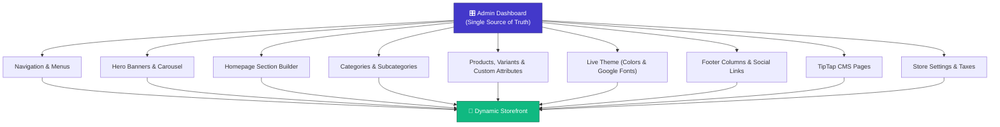

# 🛍️ RIAS — Ryzotek Indigenous Admin Systems

> **The Ultimate Admin-Controlled E-Commerce Platform & Storefront Engine**
> Built with Next.js 15/16 App Router, React 19, TypeScript, Tailwind CSS 4, Prisma, and NextAuth.

[](LICENSE)
[](https://nextjs.org/)
[](https://react.dev/)
[](https://www.typescriptlang.org/)
[](https://tailwindcss.com/)
[](https://www.prisma.io/)

---

## 🌟 Philosophy: The 100% Dynamic Storefront

Most e-commerce templates hardcode categories, banners, navigation menus, and color schemes into JSX code. **RIAS takes the opposite approach:**

The storefront is a **blank canvas**. Every single customer-facing element — from brand colors, fonts, and header navigation trees to announcement bars, hero carousels, custom homepage sections, categories, product attributes, and footer columns — is configured and managed directly by the store owner through the **Admin Dashboard**.



---

## ✨ Features

### 🎨 Live Theme & Branding Customizer
- **Color Engine**: Pick brand primary, secondary, accent, background, text, and dark mode colors with real-time CSS variable updates.
- **Typography Selector**: Choose from Google Fonts (`Inter`, `Poppins`, `Montserrat`, `Playfair Display`, `Roboto`, etc.) dynamically loaded without hardcoded styles.
- **Brand Assets**: Header logo, footer logo, favicon, and OpenGraph images managed via media library.
- **Maintenance Mode**: One-click maintenance screen toggle with customizable messaging.

### 🏠 Visual Storefront Builder
- **Hero Carousel Manager**: Add slides with title, subtitle, CTA text, CTA destination, background imagery, and overlay color blending.
- **Drag-and-Drop Homepage Sections**: Reorder homepage blocks seamlessly (Featured Products, Category Showcase, Promotional Banners, Testimonials, Newsletter, and Custom HTML).
- **Hierarchical Navigation Tree**: Build nested header dropdowns and multi-column footers with drag-and-drop sort order.
- **Sticky Announcement Bar**: Customizable banner strip with live preview, links, and background/text color pickers.

### 📦 Comprehensive Catalog Management
- **Categories & Subcategories**: Fully custom hierarchies with auto-generated slugs, descriptions, and cover photos.
- **Products & Dynamic Variants**: Add unlimited variant types (Size, Color, Material, etc.) with SKU, stock, and price overrides.
- **Custom Dynamic Attributes**: Define arbitrary label/value specifications per product (e.g. Dimensions, Origin, Weight).
- **Rich Text Descriptions**: Powered by TipTap editor with support for rich formatting, tables, lists, and images.

### 🛒 Complete Commerce & Checkout Flow
- **Shopping Cart**: Zustand-powered persistent slide-out sheet and dedicated `/cart` page with real-time tax, shipping, and discount calculation.
- **Coupon System**: Percentage and fixed discount codes with expiration dates, minimum order values, and usage count limits.
- **Streamlined Checkout**: Step-by-step guest or authenticated checkout with live shipping method selection.
- **Order Tracking**: Visual 4-step order progress timeline (`PENDING` → `PROCESSING` → `SHIPPED` → `DELIVERED`).
- **Wishlist & Customer Account**: Persistent customer wishlist and account portal with order history and saved addresses.

### 📊 Admin Intelligence & Operations
- **Analytics Dashboard**: Recharts-powered revenue trends, order distribution by status, and top-performing products.
- **Order Management**: Filterable orders table with status updater, line item inspection, and customer details.
- **Customer Directory**: Customer profiles, order histories, and contact records.
- **Review Moderation**: Star ratings and customer testimonials moderation queue.
- **Media Library**: Drag-and-drop image upload manager with copyable asset URLs.

---

## 🛠️ Tech Stack

| Layer | Technologies |
|---|---|
| **Framework** | [Next.js 15/16](https://nextjs.org/) (App Router, Server Actions, Route Groups) |
| **Language** | [TypeScript 5](https://www.typescriptlang.org/) |
| **Styling** | [Tailwind CSS 4](https://tailwindcss.com/) + Dynamic CSS Custom Properties |
| **Database & ORM** | SQLite via [Prisma ORM 6](https://www.prisma.io/) (Zero-config, portable) |
| **Authentication** | [NextAuth.js v5 (Auth.js)](https://authjs.dev/) with Credentials Provider |
| **State Management** | [Zustand](https://zustand-demo.pmnd.rs/) with `persist` middleware |
| **Data Visualizations** | [Recharts 3](https://recharts.org/) |
| **Rich Text Editing** | [TipTap Editor](https://tiptap.dev/) |
| **Drag & Drop** | [@dnd-kit](https://dndkit.com/) (Core + Sortable) |
| **Forms & Validation**| [React Hook Form](https://react-hook-form.com/) + [Zod 4](https://zod.dev/) |
| **Icons & Toasts** | [Lucide React](https://lucide.dev/) + [Sonner](https://sonner.emilkowal.ski/) |
| **Package Manager** | [pnpm](https://pnpm.io/) |

---

## 🚀 Quick Start

### 1. Prerequisites
- **Node.js** 20.x or higher
- **pnpm** 10.x or higher (`npm install -g pnpm`)

### 2. Clone & Install
```bash
git clone https://github.com/your-username/rias.git
cd rias
pnpm install
```

### 3. Configure Environment
Copy the example environment template:
```bash
cp .env.example .env
```

Generate a secure authentication secret and update `.env`:
```env
DATABASE_URL="file:./dev.db"
NEXTAUTH_SECRET="your-generated-random-secret"
NEXTAUTH_URL="http://localhost:3000"
```

### 4. Initialize Database & Seed Demo Data
Push schema to SQLite and run the seed script:
```bash
pnpm db:push
pnpm db:seed
```

### 5. Run Development Server
```bash
pnpm dev
```

Open [http://localhost:3000](http://localhost:3000) in your browser.

---

## 🔑 Default Credentials (Local Demo)

When seeded, the following demo accounts are created:

| Role | Email | Password | Access |
|---|---|---|---|
| **Admin** | `admin@rias.dev` | `admin123` | [http://localhost:3000/admin/login](http://localhost:3000/admin/login) |
| **Customer** | `customer@rias.dev` | `customer123` | [http://localhost:3000/account](http://localhost:3000/account) |

> ⚠️ **Important**: In production, change default credentials immediately and set a strong `NEXTAUTH_SECRET`.

---

## 📂 Project Structure

```
rias/
├── prisma/
│   ├── schema.prisma          # 27-model relational schema
│   ├── seed.ts                # Initial admin, settings, categories & demo catalog
│   └── dev.db                 # Local SQLite database (ignored in git)
├── public/
│   └── uploads/               # Uploaded images (ignored in git except .gitkeep)
├── src/
│   ├── app/
│   │   ├── (admin)/           # Protected admin dashboard route group
│   │   │   ├── admin/
│   │   │   │   ├── analytics/ # Recharts analytics dashboard
│   │   │   │   ├── categories/# Category & subcategory CRUD
│   │   │   │   ├── coupons/   # Discount coupon manager
│   │   │   │   ├── customers/ # Customer records & orders
│   │   │   │   ├── media/     # Media library asset manager
│   │   │   │   ├── orders/    # Order management & status workflow
│   │   │   │   ├── pages/     # TipTap CMS page editor
│   │   │   │   ├── products/  # Product & variant catalog manager
│   │   │   │   ├── reviews/   # Customer review moderation
│   │   │   │   ├── settings/  # Taxes, currency, store settings
│   │   │   │   ├── storefront/# Drag & drop homepage & menu builders
│   │   │   │   └── theme/     # Color pickers & Google Fonts editor
│   │   ├── (store)/           # Public storefront route group (renders from DB)
│   │   │   ├── account/       # Customer dashboard & address book
│   │   │   ├── cart/          # Shopping cart page
│   │   │   ├── categories/    # Dynamic category & subcategory listings
│   │   │   ├── checkout/      # Multi-step checkout
│   │   │   ├── orders/        # Order tracking & print receipts
│   │   │   ├── pages/         # Dynamic CMS content pages
│   │   │   ├── products/      # Product catalog & details with gallery
│   │   │   └── wishlist/      # Customer wishlist
│   │   ├── admin/login/       # Standalone admin login page
│   │   ├── api/               # REST API endpoints for store & admin
│   │   ├── globals.css        # Dynamic theme variable definitions
│   │   ├── layout.tsx         # Root layout with fonts & toast provider
│   │   ├── not-found.tsx      # Branded 404 page
│   │   └── error.tsx          # Client-side error boundary
│   ├── components/
│   │   ├── admin/             # Dashboard UI components & builders
│   │   └── store/             # Storefront dynamic rendering components
│   ├── hooks/                 # Custom React hooks (useCart, useDebounce, etc.)
│   ├── lib/                   # Database client, auth, helpers & validators
│   ├── stores/                # Zustand client state stores
│   └── types/                 # TypeScript interfaces & declarations
├── .env.example               # Template environment configuration
├── CONTRIBUTING.md            # Open source contribution guide
├── LICENSE                    # MIT License
└── package.json
```

---

## 📜 Available Scripts

| Command | Description |
|---|---|
| `pnpm dev` | Starts local development server on port 3000 |
| `pnpm build` | Compiles and builds production bundle |
| `pnpm start` | Runs the compiled production server |
| `pnpm lint` | Runs ESLint analysis |
| `pnpm db:push` | Synchronizes Prisma schema directly with database |
| `pnpm db:seed` | Populates database with default config and demo catalog |
| `pnpm db:generate`| Re-generates Prisma Client types |

---

## 🔒 Security & Privacy

- **Zero Hardcoded Secrets**: All authentication keys and database credentials are read from environment variables.
- **Excluded Data**: `.gitignore` strictly excludes `.env*` files, local SQLite databases (`*.db`, `*.db-journal`), local uploaded assets (`/public/uploads/*`), and build caches.
- **Password Security**: Passwords are encrypted with `bcryptjs` (salt rounds: 10).
- **Authentication Guard**: Admin API routes enforce session authentication and `ADMIN` role checks.

---

## 🤝 Contributing

Contributions are welcome! Please read [CONTRIBUTING.md](CONTRIBUTING.md) for details on our code of conduct, development setup, and pull request workflow.

---

## 📄 License

This project is licensed under the [MIT License](LICENSE).
